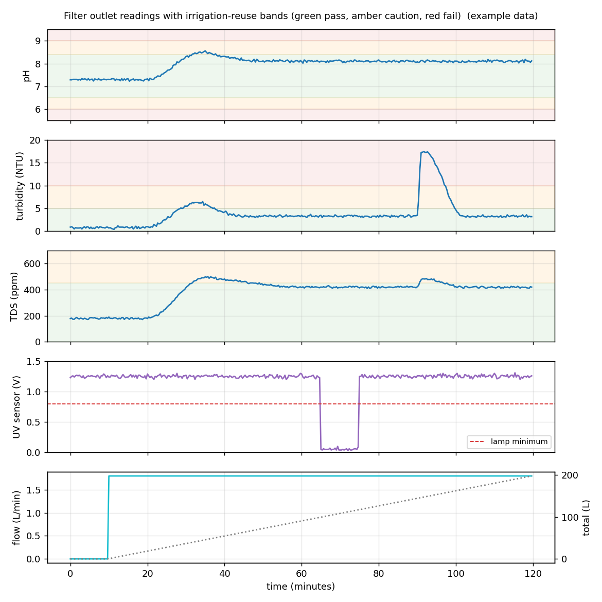
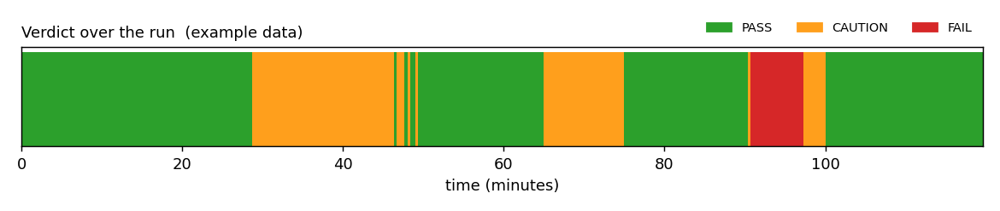

# Greywater Quality Monitor

A sensor unit that sits at the outlet of a multi-stage greywater filter and reports whether the treated water is suitable for reuse on plants. Built on a Raspberry Pi Pico W during the JEI Summer School at Hubei University, Wuhan, as part of an international team project that placed third.

The chemistry students on the team designed the filter stages. My part was the sensing and verification: choosing and calibrating the sensors, wiring the unit, writing the firmware, and deciding how to turn the readings into a clear "use it / don't use it" answer. The water was intended for irrigation only, never for drinking, and the thresholds reflect that.



## What it does

- **Measures six things** every 20 s: pH, turbidity, total dissolved solids (TDS), water temperature, the output of the UV sterilising lamp, and the flow rate and volume through the outlet valve.
- **Classifies each sample** as PASS, CAUTION or FAIL against irrigation-water guidelines (FAO and WHO greywater reuse guidance, simplified into bands). A PASS also requires the UV lamp to be working, because clear-looking water that has not been disinfected is still not safe to put on food plants.
- **Explains the verdict** with short reasons such as "turbidity caution" or "UV lamp weak or off", shown on the serial console and stored in the log.
- **Logs locally** to the Pico's flash and **uploads to a ThingSpeak dashboard** over Wi-Fi when credentials are present. Credentials live in a `secrets.py` that is excluded from git.
- **Signals on the LED:** one blink per sample for PASS, two for CAUTION, steady on for FAIL.

`analysis/plot_log.py` draws a log with the pass, caution and fail bands behind each trace, plus a verdict timeline, and prints how much of the run passed and why samples failed.



## Hardware

| Part | Notes |
|---|---|
| Raspberry Pi Pico W | MicroPython, Wi-Fi to ThingSpeak |
| ADS1115 16-bit ADC (I2C) | The Pico has only three analogue inputs and the pH probe needs better resolution than its 12-bit ADC |
| pH probe with analogue board | Two-point calibrated in pH 4 and pH 7 buffers |
| Turbidity sensor (DFRobot SEN0189) | Calibrated against clear water and a 100 NTU standard |
| TDS probe (Gravity TDS meter) | Manufacturer's cubic fit with 2 %/°C temperature compensation |
| UV sensor (GUVA-S12SD) | Mounted at the UV sterilising stage to confirm the lamp is actually producing UV |
| DS18B20 waterproof probe | Water temperature, also used for TDS compensation |
| YF-S201 hall-effect flow sensor | At the outlet valve, 450 pulses per litre |

Wiring: ADS1115 on GP4 (SDA) and GP5 (SCL); DS18B20 on GP16; flow sensor on GP17. Analogue sensors are powered from 5 V and read through the ADS1115 at a 6.144 V full-scale range so they cannot clip.

## Software

- Firmware: MicroPython 1.22 or newer on the Pico W. Uses the built-in `onewire`, `ds18x20`, `network` and `urequests` modules; the ADS1115 driver is included.
- Analysis: Python 3.10 or newer with `matplotlib`.

```
firmware/
  main.py              read, classify, log, upload, repeat
  sensors.py           voltage-to-value conversions, DS18B20, flow meter
  quality.py           thresholds and the PASS / CAUTION / FAIL decision (shared with analysis)
  ads1115.py           minimal ADS1115 driver
  thingspeak.py        Wi-Fi connect and channel update
  logger.py            CSV log on the Pico
  config.py            pins, calibration constants, periods
  secrets_example.py   template for Wi-Fi and ThingSpeak credentials
analysis/
  plot_log.py          plots and summary for a log
  test_quality.py      checks for the conversions and the classifier
  example_data.py      generates data/example_log.csv (a scripted bench-test scenario)
data/
  example_log.csv      generated example, not a measurement
docs/                  images for this README
```

## How to run

**On the Pico**

1. Flash MicroPython to the Pico W.
2. Copy `firmware/secrets_example.py` to `secrets.py`, fill in the Wi-Fi details and ThingSpeak write key (or leave the key empty to log locally only).
3. Copy every file in `firmware/` plus `secrets.py` to the Pico (Thonny: *File > Save as > Raspberry Pi Pico*).
4. Calibrate: put the pH probe in pH 7 and pH 4 buffers and note the voltages printed on the console, then enter them in `config.py`. Do the same for the turbidity sensor with clear water and a 100 NTU standard.
5. Power up. `main.py` starts automatically and prints one line per sample.

**On a PC**

```bash
git clone https://github.com/siamct/greywater-quality-monitor.git
cd greywater-quality-monitor/analysis
pip install -r requirements.txt
python test_quality.py                 # checks the conversions and the classifier
python plot_log.py path/to/log.csv     # or no argument for the example data
```

## Thresholds

| Measurement | PASS | CAUTION | FAIL |
|---|---|---|---|
| pH | 6.5 to 8.4 | 6.0 to 9.0 | outside |
| Turbidity | under 5 NTU | 5 to 10 NTU | over 10 NTU |
| TDS | under 450 ppm | 450 to 2000 ppm | over 2000 ppm |
| Temperature | 5 to 35 °C | 2 to 40 °C | outside |
| UV lamp | above 0.8 V at the sensor | lamp off downgrades PASS to CAUTION | |

The overall verdict is the worst individual band.

## Results

The plots above are from a scripted bench-test scenario in `analysis/example_data.py`: tap water, then washing-up water through the filter, a period with the UV lamp switched off, and a slug of soil that the filter clears. They show the kind of record the unit produces and how the verdict responds; they are not measurements from Wuhan.

During the summer school the unit ran on the team's filter rig with washing-up and hand-basin water. Treated water came out in the PASS band for irrigation on pH and turbidity, with TDS usually in the caution band because detergent residue is not removed by sand and carbon stages. The team placed third in the final judging.

## What I learned

- **Calibrate in the water you will measure.** The pH and turbidity sensors shipped with "typical" curves that were well off for our probes. Two-point calibration in buffers took ten minutes and removed a whole pH unit of error.
- **TDS needs temperature compensation.** Conductivity rises about 2 % per degree, so without the DS18B20 the TDS reading drifted with the weather rather than with the water.
- **Clear is not clean.** Turbidity and TDS say nothing about microbes. Reading the UV lamp's actual output and refusing to say PASS without it was the most important decision in the classifier.
- **Give a verdict, not just numbers.** The people using the rig wanted a yes or no. Bands and a one-line reason were far more useful than a dashboard of raw values.
- **Keep secrets out of the repo.** Wi-Fi and API keys live in a file git never sees, with a committed example to copy.

## Licence

MIT. See [LICENSE](LICENSE).
