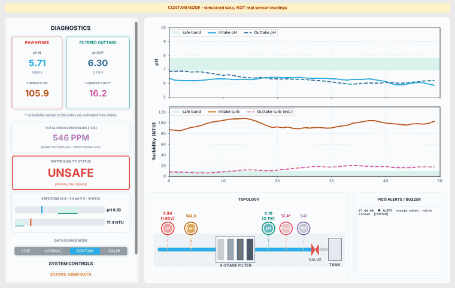
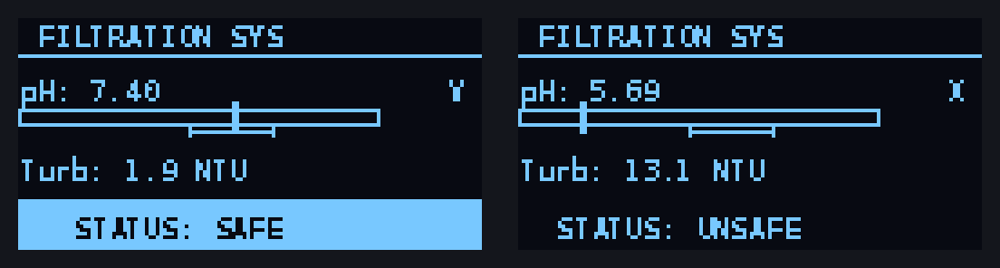

# Greywater filtration monitor

A Raspberry Pi Pico that watches water going through a 4-stage greywater filter and only lets it into the collection tank (for reuse on plants) when it looks safe. A desktop dashboard shows the readings live, graphs them, logs them and can lock or unlock the outlet valve.



*The dashboard in CONTAM demo mode (simulated dirty water, hence the yellow banner): filtered pH has dropped out of the green band and the estimated turbidity is over 10 NTU, so it says UNSAFE, the valve is drawn red (forced shut) and the alert is logged. In LIVE mode the same screen shows the Pico's readings and probe voltages.*

## How it works

1. Greywater goes in, past a **pH probe** and a **turbidity sensor** on the intake.
2. It runs through the 4-stage filter.
3. A second **pH probe** checks the filtered water.
4. If the filtered water is safe, and the valve has been unlocked (button or dashboard), a **servo valve** opens to the collection tank. If it turns unsafe, the valve shuts straight away and the buzzer goes off (see below).

**Safe** means filtered pH between 6.9 and 7.8 and filtered turbidity under 10 NTU.

The Pico also shows pH (with the safe band), turbidity and SAFE/UNSAFE on a 128×64 OLED, and lights the safe LED when the water is safe.



*The OLED, drawn by the firmware's own `draw()` code (rendered on a PC, not a photo). The bar is pH 5 to 9 with the safe band marked under it. Top right: `V` valve open, `L` locked by the user, `X` shut because the water is unsafe.*

## Buzzer and LEDs

The buzzer is there so you don't have to watch the screen. It only makes noise when something changes:

| What happened | Buzzer | Serial message |
|---|---|---|
| Water goes from safe to unsafe | 3 short beeps | `ALERT: unsafe water, valve closed` |
| Still unsafe | 1 longer beep every 15 s | `ALERT: still unsafe` |
| Back in range | 1 short chirp | `OK: water back in range` |
| Lock button pressed / LOCK or UNLOCK sent | tiny click | `Action: LOCKED` / `Action: UNLOCKED` |

It doesn't beep the whole time the water is bad, because that just gets switched off at the wall. The reminder every 15 s is so it can't be forgotten about either.

The beeps are non-blocking. My first version did `buzzer on, sleep, buzzer off` inside the loop, which froze the sensors and the button while it beeped (and it only lasted 10 ms, so you could barely hear it). Now each pattern is a list of on/off times that the main loop steps through, so readings keep going at 10 Hz while it beeps.

LEDs: the safe LED (GP20) is on when the water is safe; the lock LED (GP19) is on when the valve is locked by the user. The dashboard's **Pico alerts / buzzer** panel shows the same messages with a timestamp, so you can see what it beeped about after the fact.

## What's real and what isn't

- **Measured:** intake pH, outtake pH, intake turbidity.
- **Estimated:** outtake turbidity. There's only one turbidity sensor, so the outlet value assumes the filter removes 85 %. It's labelled as an estimate everywhere.
- **Not fitted yet:** TDS (total dissolved solids). The dashboard shows STANDBY in live mode.
- **Demo modes:** the dashboard can make up data to show it without the rig: NORMAL (clean water), CONTAM (dirty water) and CALIB (sliders for the filtered pH and turbidity, handy for checking the safety logic). It puts a banner on screen and writes the mode into every log row, so demo data can't be mistaken for readings. The CSV logs from the project that are just smooth repeating waves were from the simulator, not the rig, so they're not in this repo.

## Hardware

| Pico pin | Connected to |
|---|---|
| GP26 (ADC) | Turbidity sensor, intake |
| GP27 (ADC) | pH probe, outtake |
| GP28 (ADC) | pH probe, intake |
| GP22 | Valve servo (50 Hz) |
| GP21 | Lock button (to 3V3, pulled down) |
| GP20 | "Safe" LED |
| GP19 | "Locked" LED |
| GP18 | Buzzer |
| GP4 / GP5 | OLED SDA / SCL (I2C0) |

The real screen is an SH1106. In the Wokwi simulator it falls back to an SSD1306, which is why `ssd1306.py` is included.

## Files

```
firmware/main.py          runs on the Pico
firmware/ssd1306.py       OLED driver (from MicroPython, MIT licence)
tools/sensor_check.py     prints every sensor's voltage, for wiring checks and calibration
tools/calibrate_ph.py     turns buffer readings into calibration constants (runs on a PC)
gui/dashboard.py          desktop dashboard
gui/requirements.txt
docs/                     pictures for this page
```

**Pico:** copy `firmware/main.py` and the OLED driver to the Pico. Run `tools/sensor_check.py` first if you've just wired it.

**Dashboard:** `pip install -r gui/requirements.txt`, then `python gui/dashboard.py`. It finds the Pico by itself and logs to `differential_filtration_log.csv` once a second.

## Serial messages

Pico → PC, once every 100 ms:

```
ph_in, ph_out, turb_in, turb_out_est, valve_open, safe, v_ph_in, v_ph_out, v_turb
```

Plus the text lines from the buzzer table above. PC → Pico: `LOCK` or `UNLOCK`.

## Calibration

pH is worked out as `slope × volts + offset`, with separate constants for each probe (`PH_IN_CAL`, `PH_OUT_CAL`). To recalibrate, put a probe in buffer solutions of known pH, read the voltage with `sensor_check.py`, and run:

```
python tools/calibrate_ph.py 6.86=2.12 7.2=2.33 9.18=2.38
```

Those are my actual readings from one probe, and they show a problem: the pH 9.18 buffer only read 0.05 V higher than the 7.2 one, so the straight-line fit is off by more than 1 pH there. Either the probe was slow to settle, or it needs cleaning or replacing. Readings above about 7.5 shouldn't be trusted until it's recalibrated.

## Tidied up after the project

The project grew through a lot of small test scripts written against a deadline. Since then I've merged them and cleaned things up:

- **Fixed a valve bug.** In the original, if the water stayed unsafe, the valve opened again on the very next loop. Now it stays shut until the water is safe again *and* the valve is unlocked.
- The dashboard's **valve button actually works**: it sends LOCK/UNLOCK to the Pico, and the Pico reports the real valve state back.
- Calibration constants and safety limits are named in one place, the button doesn't block the loop, and the serial reader ignores alerts and garbled lines.
- The dashboard reads serial on a background thread without touching the GUI from it, only connects to the Pico (not whatever port is first), and shows the Pico's real voltages instead of guessing them back from the pH.
- Demo data is clearly marked, and the log is written once a second with a mode column instead of 20 times a second with no way to tell real from demo.
- The buzzer no longer blocks the loop, and it has distinct patterns for unsafe / still unsafe / recovered / button (it used to be one 10 ms beep).
- The dashboard keeps my original layout (diagnostics panel, OLED-style bars, topology drawing) but the safe band is shaded on the graphs, the topology scales to the window instead of being cut off, and there's an alerts panel.
- The safety status is checked on the newest reading, not the smoothed one, so the dashboard doesn't say SAFE for a second after the Pico has already shut the valve.
